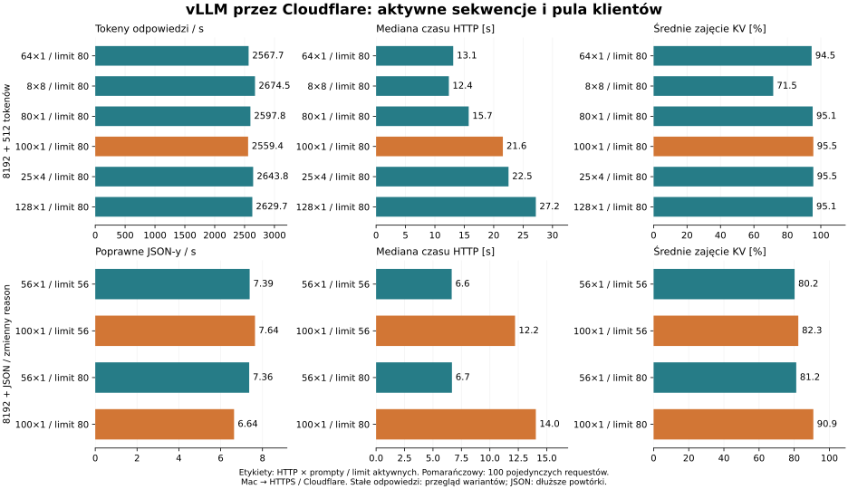

# vLLM: kolejka, aktywne sekwencje i wydajność przez Cloudflare

**Aktualizacja:** [dalsze strojenie](vllm-json-tuning-benchmark.md) tego samego
profilu sprawdziło wyłączenie MTP i uzyskało lepszy wynik przy 64 aktywnych.
[Kontrola cap i puli klienta](vllm-cap-client-followup.md) pozostawiła cap 64
i wskazała pulę 80 dla tego krótkiego JSON-a. Poniższe wyniki zachowują
pierwotne MTP×4.

Pomiar z 15 września 2026 sprawdza, czy stale uzupełniana pula 100 requestów
jest najwydajniejszym sposobem obsługi zadań. Rozdzielamy limit aktywnej pracy
na GPU od liczby zadań już wysłanych przez klienta.

## Wynik i zalecenie dla badanego profilu

**Najlepszy ze sprawdzonych wariantów dla JSON-a: 100 pojedynczych requestów
w toku przy `max_num_seqs=56`.** Klient dosyła kolejne zadanie po każdej
odpowiedzi, a vLLM utrzymuje zapas w kolejce. W 90-sekundowym oknie wariant
ten osiągnął **7,64 poprawnego JSON-a/s i 1081 tokenów odpowiedzi/s**.
Sam wzrost puli klienta do 100 przy limicie silnika 80 nie był optymalny.

| Limit aktywnych | Requesty w toku | JSON-y/s | Tokeny/s | GPU średnio | KV średnio | Mediana HTTP |
|---:|---:|---:|---:|---:|---:|---:|
| 80 | 56 | 7.36 | 1048 | 91.8% | 81.2% | 6.67 s |
| 80 | 100 | 6.64 | 934 | 93.0% | 90.9% | 14.04 s |
| 56 | 100 | 7.64 | 1081 | 91.6% | 82.3% | 12.22 s |
| 56 | 56 | 7.39 | 1051 | 87.6% | 80.2% | 6.65 s |

Przy 100 requestach obniżenie limitu aktywnych z 80 do 56 dało około
**15% więcej JSON-ów/s**. Przy tym samym limicie 56 zwiększenie puli klienta
z 56 do 100 dało mniejszą korzyść: około **3,4% więcej JSON-ów/s** i 2,8%
więcej tokenów/s. To wynik pojedynczej dłuższej pary pomiarów na limicie 56;
nie ustala dokładnej minimalnej wielkości backlogu potrzebnej do tej wydajności.
Pula np. 64 lub 80 przy limicie 56 nie była osobno mierzona.

W zwycięskim wariancie średnio **54,7 sekwencji pracowało**, a **42,4 czekało**.
Szczytowe KV wynosiło **91,4%**, nie było preemption. GPU miało średnio
**91,6% wykorzystania** w próbkach co sekundę i pobierało średnio około
**445 W** przy limicie 450 W. Nie utrzymywało stale 100% utilization, mimo
że był to najszybszy zmierzony wariant JSON.

Limit 56 był wariantem testowym. Bezpośrednio po tej historycznej serii
produkcja wróciła do 80 i oryginalnego klucza API; późniejsze testy awansowały
MTP off / cap 64 do trwałej konfiguracji. Wynik dotyczy promptów 8192 tokeny i tego syntetycznego schematu,
ze średnio około 142 tokenami odpowiedzi. Nie jest uniwersalnym optimum
dla wszystkich długości kontekstu, odpowiedzi i rodzajów zadań.

Dalsze [porównanie MTP×2/×3/×4](vllm-mtp-json-benchmark.md) przy limicie 56
i puli 100 requestów wykazało niewielką przewagę ×2/×3 nad użytym tutaj ×4.

## Przegląd wariantów przy limicie silnika 80

### Stałe 512 tokenów odpowiedzi

| HTTP × prompty | Tokeny/s | KV średnio | Mediana HTTP |
|---|---:|---:|---:|
| 64×1 | 2568 | 94.5% | 13.11 s |
| 100×1 | 2559 | 95.5% | 21.56 s |
| 8×8 | 2675 | 71.5% | 12.37 s |
| 80×1 | 2598 | 95.1% | 15.75 s |
| 25×4 | 2644 | 95.5% | 22.52 s |
| 128×1 | 2630 | 95.1% | 27.17 s |

### JSON ze zmiennym `reason`

| HTTP × prompty | JSON-y/s | Tokeny/s | KV średnio | Trafienia prefix cache |
|---|---:|---:|---:|---:|
| 64×1 | 6.97 | 977 | 94.1% | 65.3% |
| 100×1 | 6.78 | 943 | 95.6% | 63.4% |
| 8×8 | 6.26 | 911 | 52.9% | 72.6% |
| 48×1 | 7.35 | 1043 | 68.5% | 71.6% |
| 80×1 | 6.75 | 935 | 95.8% | 63.0% |
| 128×1 | 6.73 | 940 | 95.7% | 63.3% |
| 25×4 | 6.53 | 983 | 79.6% | 68.8% |
| 32×1 | 7.18 | 1032 | 45.6% | 72.7% |
| 40×1 | 7.30 | 1037 | 56.6% | 72.2% |
| 56×1 | 7.33 | 1046 | 80.8% | 69.9% |

Pule 32–56 pojedynczych requestów tworzą szeroki zakres podobnej wydajności.
56 wybrano do kontroli limitu aktywnych na podstawie najwyższego t/s
w tym przeglądzie; różnica względem 48 była bardzo mała, a liczba JSON-ów/s
praktycznie równa. Dłuższa powtórka 56 przy limicie 80 dała podobne
1048 t/s wobec 1046 t/s w przeglądzie.

Przy większych pulach spadał udział trafień we wspólny prefix. To wskazuje
na dodatkową pracę nad promptami, ale nie izoluje wpływu cache od pozostałych
efektów schedulera, grupowania pracy i MTP. Nie przypisujemy całej różnicy
jednemu mechanizmowi.

## Warunki i sposób pomiaru

- Klient działa na Macu administratora i wysyła HTTPS do `model.leads.run`
  przez Cloudflare. To rzeczywista trasa publiczna, ale nie pomiar z hosta
  docelowej aplikacji. Żądania `/health` na istniejącym połączeniu wracały
  zwykle w około 25 ms.
- RTX 5090, vLLM 0.29 / Model Runner V2, Triton attention, FlashInfer CUTLASS,
  FP8 KV, MTP×4, utilization 0.92, budżet 8192 tokenów i limit mocy 450 W.
- Scheduler działa w trybie `priority`; wszystkie mierzone zadania mają
  priorytet `0`. Ten test nie mierzy czasu reakcji pilnych zadań.
- `/v1/completions`, `n=1`, temperatura 0, bez streamingu. Klient uzupełnia
  pulę natychmiast po odebraniu całej odpowiedzi HTTP. Dla paczki oznacza to
  oczekiwanie na wszystkie jej prompty.
- Każdy wariant korzysta z tego samego banku 2048 unikalnych promptów dla
  danego profilu. Nie powtarzamy całych promptów w obrębie fazy. Odrębny
  `cache_salt` zapobiega korzystaniu z cache poprzedniej fazy.
- Przegląd wariantów: 20 s rozgrzewki + 60 s pomiaru. Dłuższe porównania:
  20 s rozgrzewki + 90 s pomiaru. Po pomiarze kończymy wszystkie wysłane zadania.
- Licznik wygenerowanych tokenów vLLM jest mierzony przez osobne połączenie
  SSH co około 250 ms. Po opróżnieniu puli musi dokładnie zgadzać się z sumą
  `usage.completion_tokens` odebranych odpowiedzi. Nie ma ponawiania błędnych
  requestów w ramach przebiegu.
- Poprawne JSON-y/s oznaczają odpowiedzi odebrane przez klienta w oknie
  pomiaru. Każdy JSON przechodzi walidację schematu, identyfikatora rekordu
  oraz pełnego zakończenia generacji. t/s pochodzi z licznika silnika;
  granice okna i oczekiwanie na resztę paczki mogą powodować różnicę między
  tempem generowania i tempem odbierania wyników.
- KV to zajęcie aktywnych bloków w przydzielonej puli, nie procent całej VRAM.
  Średnie KV, liczby aktywnych i oczekujących są ważone czasem.
- GPU utilization i pobór mocy zapisujemy przez `nvidia-smi` co sekundę.
  Porównania z zapisanym czasem fazy używają wyłącznie próbek z okna pomiaru,
  bez rozgrzewki, opróżniania puli i restartów. Dopasowanie zegarów jest
  przybliżone; próbki mają rozdzielczość jednej sekundy.

## Dwa różne profile odpowiedzi

| Profil | Prompt | Odpowiedź | Wspólny początek |
|---|---:|---|---:|
| Stała długość | 8192 tokeny | dokładnie 512 tokenów, EOS ignorowany | 6150 tokenów |
| JSON / zmienny `reason` | 8192 tokeny | schemat `record_id`, `decision`, `reason`, maks. 1024 tokeny | 6147 tokenów |

JSON nie ma ukrytego etapu thinking; prompt otwiera kanał final. W instrukcji
zmieniamy żądaną długość `reason`: około 30, 100 lub 220 słów. Model rzeczywiście
zwraca różne długości; środkowe 80% obserwacji obejmowało około 26–211 słów.
Cała odpowiedź miała średnio około 142 tokeny.

**Nie porównujemy wprost t/s między tymi profilami.** Krótsze odpowiedzi
zmieniają proporcję pracy nad wejściem i wyjściem; różnią się też instrukcje
i wymuszanie schematu. Siedem odpowiedzi po około 142 tokeny daje około
1000 t/s, podczas gdy pięć odpowiedzi po 512 tokenów daje około 2560 t/s.
Niższe t/s nie musi oznaczać mniejszej liczby gotowych zadań.

## Kolejka i aktywna praca

Przy serwerowym limicie `max_num_seqs=80` pula 100 klientów pozwala uruchomić
więcej sekwencji niż pula 48 lub 56 klientów. Taki test zmienia jednocześnie
liczbę oczekujących zadań i presję aktywnej pracy na KV. Samo oczekiwanie
w kolejce nie oznacza przydzielenia pełnego KV dla promptu.

Dlatego osobno sprawdzamy serwerowy limit 56 i porównujemy na nim pule
56 oraz 100 klientów. Większa pula ma wtedy stanowić zapas oczekujących
zadań, zamiast zwiększać maksymalną liczbę aktywnych sekwencji.

Czas HTTP obejmuje kolejkę, przetwarzanie oraz sieć. Przy podobnej
przepustowości więcej zadań w toku oznacza dłuższy pobyt w systemie.
Sam wzrost mediany czasu odpowiedzi nie dowodzi wolniejszego generowania.

## Ciepły start i wielkość KV

Przy limicie 80 rozgrzana pula KV wynosiła **8,86 GiB**. Zmiana limitu na
56 wymusiła nową kompilację; pierwszy start miał **8,38 GiB**. Przed
pomiarami zrobiono kolejny restart z zapisanymi artefaktami. Oba porównania
na limicie 56 używały ciepłej puli **8,96 GiB / 148 699 szacowanych tokenów**.
Utilization pozostało 0,92. Porównanie limitów obejmuje także tę zmianę
wynikowego przydziału KV; porównanie 56 kontra 100 klientów na limicie 56
korzysta z dokładnie tej samej konfiguracji serwera.

## Kontrola pomiarów i ograniczenia

Zakończono **20 poprawnych faz**, **10075 odpowiedzi HTTP** i
**11711 sekwencji**, w tym **9134 JSON-y zwalidowane schematem**.
Dwie niepoprawne fazy opisane poniżej pozostają w surowych danych.

Pierwszy przebieg 64×1 bez izolacji otrzymał 402 odpowiedzi, ale licznik
silnika zawierał dodatkowe 2048 tokenów. Wyłączamy go z porównań. Następne
próby używały tymczasowego klucza API wyłącznie w konfiguracji kontenera;
oryginalny plik `.env` i zapisane w nim klucze pozostały bez zmian.

Pierwsza odizolowana próba 128×1 przerwała się przez `ClientConnectorError`
podczas zestawiania HTTPS. Odebrano 372 poprawne odpowiedzi i licznik
tokenów był zgodny, ale okno pomiaru było niepełne: ta faza także jest
wyłączona z rankingu. Osobne powtórzenie 128×1 zakończyło się poprawnie.
Nie ustaliliśmy przyczyny błędu połączenia; nie przypisujemy go silnikowi.

Wstępne próby stałej długości służą przeglądowi wariantów. Przygotowanie
banku JSON częściowo nakładało się na początkowe próby tego przeglądu.
Wszystkie pomiary JSON i dłuższe porównania rozpoczęły się po zakończeniu
przygotowania danych. Wyniki nie stanowią dowodu uniwersalnego optimum
dla innych promptów, schematów, długości odpowiedzi lub opóźnień sieci.

## Odtworzenie

Narzędzia w `benchmarks/reddit-matching/`:

- `prepare-network-load.py`: przygotowuje syntetyczne prompty i sprawdza
  ich rzeczywistą długość tokenizerem modelu; uruchamiany w kontenerze modelu;
- `network-load.py`: lokalny klient HTTPS, walidacja odpowiedzi i pomiar
  liczników przez niezależny tunel SSH;
- `summarize-network-load.py`: kontrola wyników, skrócone dane, wyłączenia,
  próbki GPU i skróty SHA-256 surowych artefaktów;
- `plot-network-load.py`: wykres porównania.

Klient używał Python 3.13, aiohttp 3.14.3 i jsonschema 4.26.0.
Surowe dane, logi, polecenia i wersje skryptów znajdują się w
`benchmark-results/network-20260915/`. Banki promptów mają zapisane skróty
i nie zawierają danych produkcyjnych.

Skrócone wyniki i skróty plików: [network-results-20260915.json](../benchmarks/reddit-matching/network-results-20260915.json).
